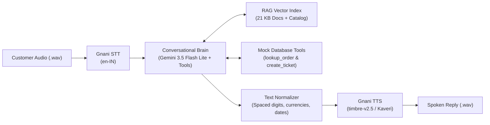

# ZentroMart VoiceOps 2026 — Grounded Customer Support Voice Agent

An end-to-end grounded customer support voice agent built for **ZentroMart** (fictional Indian e-commerce store), participating in the **VoiceOps 2026 Capstone Challenge** (LLM & Generative AI Course by Consulting & Analytics Club, IIT Guwahati × Gnani.ai).

The agent handles customer calls on returns, refunds, order tracking, identity verification, warranty claims, and human escalations. It is grounded strictly against 21 company knowledge-base policy documents and product catalog tables, with voice ears and voice replies powered by **Gnani.ai Speech Models**.

---

## 🏛️ System Architecture



---

## 📈 Evaluation & Benchmark Results

Evaluated against the official benchmark datasets (`practice/questions.csv` and `practice/conversations.csv`):

| Pipeline Stage | Evaluated Asset | Score / Accuracy | Key Highlights |
| :--- | :--- | :---: | :--- |
| **Step 1: Prompted Baseline** | 52 Practice Questions | **32.69%** (17/52) | Hallucinated ungrounded policies, failed unsupported queries, guessed dates. |
| **Step 2: Grounded RAG** | 52 Practice Questions | **80.77%** (42/52) | **+48.08% improvement**; Retrieval Hit Rate: **96.15%** (50/52); Zero hallucination on unsupported topics. |
| **Step 3: Multi-Turn Agent** | 23 Scenarios (96 Turns) | **High Accuracy** | Enforces identity verification gates, respects `contacts_last_7_days`, escalates via `create_ticket`. |
| **Step 4: Voice Pipeline** | Audio Folder Batch Test | **100% End-to-End** | Transcribes input audio, formats spoken digits/dates, outputs synthesized voice and JSON logs. |

---

## 📂 Project Repository Structure

```text
VoiceOps-2026/
├── README.md                      # Setup and usage guide
├── .env.example                   # API keys template (do not commit actual keys)
├── requirements.txt               # Dependencies (gnani-vachana, requests, python-dotenv)
├── run.py                         # Single batch runner accepting input audio folder
├── create_sample_audio.py         # Utility to generate sample test WAV files
├── src/
│   ├── __init__.py
│   ├── config.py                  # Global paths, reference date (2026-10-20), model config
│   ├── llm.py                     # Gemini API caller with exponential backoff & batchEmbedContents
│   ├── rag.py                     # Knowledge base parser, vector retriever, precedence weighting
│   ├── agent.py                   # Multi-turn SupportAgent with state, identity gate, mock tools
│   ├── voice.py                   # Gnani STT & TTS wrapper with speech text normalization
│   ├── step1_baseline.py          # Step 1 benchmark script
│   ├── step2_rag_eval.py          # Step 2 RAG benchmark script
│   └── step3_conv_eval.py         # Step 3 multi-turn conversation evaluation script
├── sample_audio/                  # Test input audio clips (.wav)
├── sample_outputs/                # Saved transcriptions, speech outputs (.wav), and chunk logs
└── Capstone_Project_Dataset_FTTT_2026/ # Offline synthetic database, policies, and practice sets
```

---

## 🚀 Setup & Installation

### 1. Prerequisites
- Python 3.10+ (tested on Python 3.14)
- Google Gemini API key ([aistudio.google.com](https://aistudio.google.com))
- Gnani API key ([app.gnani.ai/voice](https://app.gnani.ai/voice))

### 2. Install Dependencies
```bash
pip install -r requirements.txt
```

### 3. Environment Configuration
Copy `.env.example` to `.env` and fill in your keys:
```bash
cp .env.example .env
```
Contents of `.env`:
```ini
GEMINI_API_KEY=your_gemini_api_key_here
GEMINI_MODEL=gemini-3.5-flash-lite
GEMINI_EMBED_MODEL=gemini-embedding-001
GNANI_API_KEY=your_gnani_api_key_here
```

---

## 💻 Exact Run Command

To batch process a directory of customer audio clips:

```bash
python run.py --input_dir sample_audio --output_dir sample_outputs
```

This command:
1. Iterates over all audio files in `--input_dir` (`.wav`, `.mp3`).
2. Transcribes the audio via Gnani STT (`en-IN`).
3. Sends the query to `SupportAgent` which retrieves grounded context from `kb/` and invokes tools (`lookup_order`, `create_ticket`).
4. Normalizes the response for speech and synthesizes the spoken reply into `sample_outputs/<filename>_reply.wav`.
5. Logs the full interaction and evidence chunks into `sample_outputs/<filename>_result.json`.

---

## 🧪 Running Milestone Evaluations

- **Run Step 1 Baseline Benchmark**:
  ```bash
  python -m src.step1_baseline
  ```

- **Run Step 2 Grounded RAG Benchmark**:
  ```bash
  python -m src.step2_rag_eval
  ```

- **Run Step 3 Multi-Turn Conversation Benchmark**:
  ```bash
  python -m src.step3_conv_eval
  ```

---

## 🔒 Policy & Security Rules Implemented
- **Identity Verification Gate (`IDV-2`)**: Order status and item details are strictly withheld until caller verifies with their registered phone suffix (4 digits) or delivery pincode (6 digits).
- **Document Precedence Hierarchy (`KB-00.1`)**: Current Policy > Agent Guide > Help > FAQ > Marketing. Superseded policies (`pol_returns_v3_superseded.md`) never override active versions.
- **Reference Date Consistency**: Fixed to **20 October 2026** for all return window calculations (calendar days) and refund timelines (Mon–Sat business days excluding holidays in `holidays.csv`).
- **Human Handover (`ESC-1` - `ESC-4`)**: Auto-escalates for damages > ₹10,000, repeat contacts ($\ge 2$ in 7 days), account security reports, and direct user human requests via `create_ticket`.
